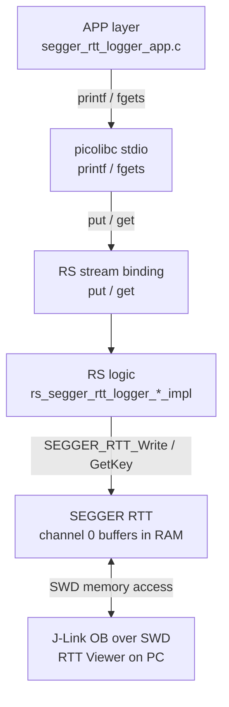
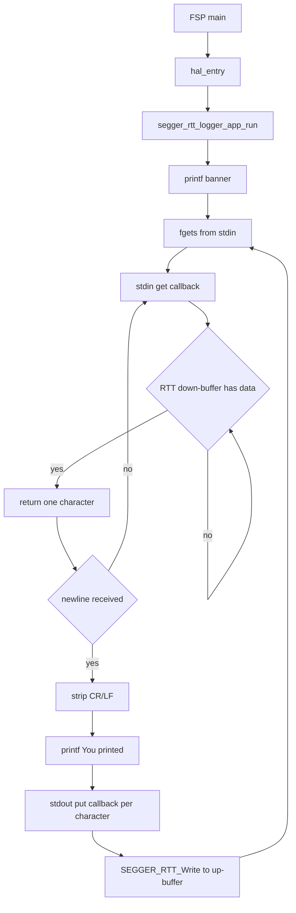
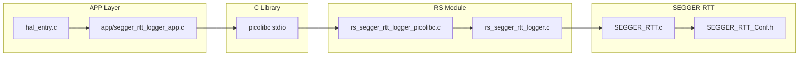
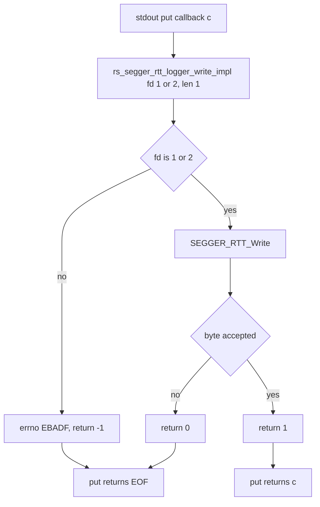

# Segger RTT Logger — Standard C stdio over SEGGER RTT
## Renesas RA · bare-metal · J-Link RTT console (no UART)

| Item | Details |
|---|---|
| **Boards** | FPB-RA0L1 · FPB-RA2E3 · FPB-RA4E2 · FPB-RA6E2 · FPB-RA8E1 |
| **Console transport** | SEGGER RTT V8.58 — channel 0 over the on-board J-Link (SWD) |
| **FSP** | v6.5.0 · bare-metal (no RTOS) · LLVM (Arm Toolchain for Embedded 21.1.1) / picolibc |
| **Public interface** | Standard C stdio (`<stdio.h>`) — no RS API to call, no init step |

> Segger RTT Logger · FSP v6.5.0 · Rev 1.3 · October 2026

---

## Table of Contents

1. [Overview](#1-overview)
2. [Key Features](#2-key-features)
3. [Running the Project](#3-running-the-project)
   - 3.1 [Supported Boards](#31-supported-boards)
   - 3.2 [Requirements](#32-requirements)
   - 3.3 [Demo Bring-Up](#33-demo-bring-up)
   - 3.4 [RTT Terminal](#34-rtt-terminal)
   - 3.5 [Other RTT Clients](#35-other-rtt-clients)
4. [FSP Configuration](#4-fsp-configuration)
   - 4.1 [BSP Settings](#41-bsp-settings)
   - 4.2 [FSP Stack Overview](#42-fsp-stack-overview)
   - 4.3 [SEGGER RTT Properties](#43-segger-rtt-properties)
5. [Data Flow Architecture](#5-data-flow-architecture)
   - 5.1 [Repository Structure](#51-repository-structure)
   - 5.2 [Software-Layer Architecture](#52-software-layer-architecture)
   - 5.3 [Execution Model](#53-execution-model)
   - 5.4 [RS Configuration](#54-rs-configuration)
   - 5.5 [RS Functions](#55-rs-functions)
6. [Runtime Behavior](#6-runtime-behavior)
   - 6.1 [Runtime Flow](#61-runtime-flow)
   - 6.2 [File-Level Ownership Flow](#62-file-level-ownership-flow)
   - 6.3 [Write Decision Flow](#63-write-decision-flow)
7. [Configuration Parameters](#7-configuration-parameters)
8. [Error Handling](#8-error-handling)
9. [Limitations](#9-limitations)
10. [Integration Recommended](#10-integration-recommended)
    - 10.1 [Integration Guide](#101-integration-guide)
    - 10.2 [Adapting to Custom Hardware](#102-adapting-to-custom-hardware)
    - 10.3 [Integration Checklist](#103-integration-checklist)
11. [Example](#11-example)
12. [Troubleshooting](#12-troubleshooting)
13. [Summary](#13-summary)
14. [References & Documentation](#14-references--documentation)

---

## 1. Overview

This project demonstrates a standard C console running over **SEGGER RTT** on Renesas RA microcontrollers. Application code uses the normal C library console — `printf`, `puts`, `putchar`, `getchar`, `scanf`, `fgets` on `stdin` / `stdout` / `stderr` — and the RS module routes it to the J-Link debug probe instead of a UART. No UART peripheral, no MCU pins, no add-on board and no USB-to-serial cable are needed: the on-board J-Link of the Fast Prototyping Board carries the console over the same USB cable used for debugging.

The application is built on **Renesas FSP v6.5.0**, bare-metal (no RTOS), with the **LLVM** toolchain (Arm Toolchain for Embedded) and its **picolibc** C library, and uses a layered software architecture:  
**APP** (Application) → **Standard C stdio** → **RS** (picolibc `stdin` / `stdout` / `stderr` streams) → **SEGGER RTT** → **J-Link** → **RTT Viewer**

Once running, the demo prints a banner, then reads each line typed in **J-Link RTT Viewer** and echoes it back as `You printed: <line>` — *existing stdio code runs unchanged; there is no RS function to call and no init step*.

The project contains one example per board in `examples/fpb-<board>/` ([3.1 Supported Boards](#31-supported-boards)). All examples run the same demo with the same sources, and each one builds in **e² studio** (managed build) and in **VS Code** (CMake / Ninja).

---

## 2. Key Features

In this project, **RS** (Renesas Software) is the software module that connects the picolibc standard streams (`stdin`, `stdout`, `stderr`) to SEGGER RTT channel 0. In the source tree it uses the `rs_` file prefix (`rs_segger_rtt_logger.c`, `rs_segger_rtt_logger_picolibc.c`). It has **no public header**: its public interface is the standard C library console.

Core RS responsibilities:

- Define the global picolibc `stdin` / `stdout` / `stderr` `FILE` objects, whose put / get callbacks call the RTT logic.
- Send `stdout` / `stderr` characters to the RTT up-buffer and read `stdin` characters from the RTT down-buffer.
- Never stall the CPU on output: when the buffer is full or no host is connected, the character is not accepted and `EOF` is reported — a character is never reported as written when it was not.
- Initialize SEGGER RTT automatically on first use — the application calls no init function.
- Use no dynamic allocation, no UART and no MCU pins. No RTOS is needed; with FreeRTOS the input wait yields with `vTaskDelay(1)`.

| libc call | picolibc stream callback | RTT operation |
|---|---|---|
| `printf`, `puts`, `putchar`, `fprintf(stdout/stderr, …)` | `put(c, stdout \| stderr)` | `SEGGER_RTT_Write(0, …)` → up-buffer 0 |
| `getchar`, `fgets`, `scanf` | `get(stdin)` | `SEGGER_RTT_HasKey()` / `SEGGER_RTT_GetKey()` ← down-buffer 0 |
| `fflush` | `flush(stream)` | Nothing to do — the RTT ring buffer is the only buffer |

---

## 3. Running the Project

What you need, how to build and flash the example of your board, and how to connect the RTT terminal. The FSP configuration and the internals of the project are described from [4. FSP Configuration](#4-fsp-configuration) on.

### 3.1 Supported Boards

| Board | MCU | Core · clock | Flash / RAM | Example folder | J-Link device |
|---|---|---|---|---|---|
| FPB-RA0L1 | R7FA0L1074CFL | Cortex-M23 · 32 MHz (HOCO) | 64 KB / 16 KB | [`examples/fpb-ra0l1`](examples/fpb-ra0l1) | `R7FA0L107` |
| FPB-RA2E3 | R7FA2E3073CFL | Cortex-M23 · 48 MHz (HOCO) | 64 KB / 16 KB | [`examples/fpb-ra2e3`](examples/fpb-ra2e3) | `R7FA2E307` |
| FPB-RA4E2 | R7FA4E2B93CFM | Cortex-M33 · 100 MHz (PLL) | 128 KB / 40 KB | [`examples/fpb-ra4e2`](examples/fpb-ra4e2) | `R7FA4E2B9` |
| FPB-RA6E2 | R7FA6E2BB3CFM | Cortex-M33 · 200 MHz (PLL) | 256 KB / 40 KB | [`examples/fpb-ra6e2`](examples/fpb-ra6e2) | `R7FA6E2BB` |
| FPB-RA8E1 | R7FA8E1AFDCFB | Cortex-M85 · 360 MHz (PLL) | 1 MB / 512 KB | [`examples/fpb-ra8e1`](examples/fpb-ra8e1) | `R7FA8E1AF` |

All examples are validated on hardware with e² studio and VS Code builds. On every board the debug interface is the **J10** micro-USB connector of the on-board J-Link OB (SWD), only the SWD debug pins are configured, and no add-on board is used. The demo needs about 10–15 KB of flash and 2.3 KB of RAM (including the 1 KB main stack and the 1.2 KB RTT buffers); see the sizes per board in [Step 4](#step-4-build).

In the steps below, `fpb-<board>` stands for the example folder and project name of your board, for example `fpb-ra4e2`.

### 3.2 Requirements

**Hardware:** one of the boards in [3.1 Supported Boards](#31-supported-boards) and a micro-USB cable. The on-board J-Link OB accesses the MCU over SWD and reads/writes the RTT buffers in RAM while the CPU runs; J-Link RTT Viewer on the PC shows the output and sends keyboard input. The RTT link works both during an IDE debug session and with the board running stand-alone.

**Software:**

| Software | Version / Notes |
|---|---|
| Renesas e² studio | With FSP 6.5.0 installed (e² studio project) |
| VS Code + Renesas extension | CMake / Ninja build — requires the CMake Tools extension and Ninja |
| Renesas FSP | v6.5.0 |
| Renesas RA Smart Configurator (RASC) | FSP 6.5.0 — used by the CMake build to generate project content |
| LLVM toolchain | Arm Toolchain for Embedded (ATfE) 21.1.1, with picolibc 1.8.10 |
| SEGGER J-Link Software Package | Validated with V9.14a — includes **J-Link RTT Viewer** |
| SEGGER RTT | V8.58 — latest official release: unmodified `SEGGER_RTT.c` / `.h` / `SEGGER_RTT_ConfDefaults.h` from [github.com/SEGGERMicro/RTT](https://github.com/SEGGERMicro/RTT) (tag V8.58), bundled in `src/segger_rtt/` with SEGGER's `LICENSE.md` (SEGGER BSD license); `SEGGER_RTT_Conf.h` is the project's own configuration — see `src/segger_rtt/README.md` |

No FSP peripheral driver, no RTOS and no heap are required by the RS.

For detailed steps on using e² studio, refer to the Renesas e² studio User Guide:
[e² studio | Renesas](https://www.renesas.com/en/software-tool/e2-studio)

### 3.3 Demo Bring-Up

The project name is **`fpb-<board>`** in both build flows. Output files:

| Build flow | Output folder | Files |
|---|---|---|
| e² studio (managed build) | `Debug/` | `fpb-<board>.elf` · `.srec` · `.map` |
| VS Code (CMake / Ninja) | `build/Debug/` | `fpb-<board>.elf` · `.hex` · `.map` |

#### Step 1: Hardware Setup

1. Connect a micro-USB cable from the PC to **J10** on the board. The board powers on and the on-board J-Link enumerates.
2. No other connection is needed — there is no add-on board and no UART adapter.

#### Step 2: Add Project to IDE

> **Note:** Use step **2.A** for **e² studio** and step **2.B** for **VS Code**

#### Step 2.A: Import the Project into e² studio

1. Launch **e² studio** and select or create a workspace. The path must **not contain spaces**.  
   `C:\workSpace` ← Good &nbsp;&nbsp; `C:\work Space` ← Bad
2. **File → Import → General → Existing Projects into Workspace → Next**.
3. Click **Browse** → navigate to `examples/fpb-<board>`. The wizard detects **fpb-&lt;board&gt;** automatically. Click **Finish**.
4. The project ships with two build configurations: **Debug** and **Release**. For bring-up, right-click the project → **Build Configurations → Set Active → Debug**.

#### Step 2.B: Open Project into VS Code

1. Define two environment variables **before** starting VS Code:
   - `ARM_LLVM_TOOLCHAIN_PATH` — the `bin` folder of the LLVM toolchain, for example  
     `C:/Users/<user>/AppData/Local/Programs/Renesas/e2_studio/toolchains/llvm_arm/ATfE-21.1.1-Windows-x86_64/bin`
   - `RASC_EXE_PATH` — the FSP 6.5.0 RA Smart Configurator executable, for example  
     `C:/Users/<user>/.renesas/platform/sc/ra/fsp_6.5.0/eclipse/rasc.exe`
2. Launch **VS Code** and **File → Open Folder**.
3. Navigate to the example folder (`examples/fpb-<board>`, not the repository root). Click **Select Folder**.
4. When prompted for a kit, select **ARM LLVM - Ninja**.
5. The default build configuration is **Debug**, and this is the one you need.

> **Note:** `RASC_EXE_PATH` is required: during CMake configure, RASC generates the linker files (`bsp_linker_info.h`, `fsp_gen.lld`, `memory_regions.lld`). Without it the build fails with `'bsp_linker_info.h' file not found`. Avoid spaces in the toolchain and project paths.

#### Step 3: Review FSP Configuration

Double-click `configuration.xml` to open the RA Configuration view. Verify the BSP tab (the MCU of your board from [3.1 Supported Boards](#31-supported-boards), FSP 6.5.0, heap 0, main stack 0x400). The Stacks tab contains only the default `g_ioport` instance, and the Pins tab needs no changes — the RTT console uses no pins.

#### Step 4: Build

> **Note:** Use step **4.A** for **e² studio** and step **4.B** for **VS Code**

#### Step 4.A: Build e² studio

1. Confirm the active build configuration is **Debug**.
2. Press **Ctrl+B** or right-click the project → **Build Project**.
3. A successful build prints zero errors and the image size (`llvm-size`).

Output files are written to `Debug/`: `fpb-<board>.elf` · `.srec` · `.map`

#### Step 4.B: Build VS Code

1. Press the Build icon on the bottom bar, or the Build button in the **CMake** tool on the right panel.
2. The first configure runs RASC to generate project content (this takes a few seconds). A successful build ends with `Build finished with exit code 0`. Check the image size with `llvm-size build/Debug/fpb-<board>.elf`.

Output files are written to `build/Debug/`: `fpb-<board>.elf` · `.hex` · `.map`

Image size of the Debug builds (`text` / `data` / `bss`, bytes):

| Board | e² studio (`Debug/`) | VS Code (`build/Debug/`) |
|---|---|---|
| FPB-RA0L1 | 10,678 / 36 / 2,268 | 10,702 / 36 / 2,268 |
| FPB-RA2E3 | 10,810 / 36 / 2,284 | 10,810 / 36 / 2,284 |
| FPB-RA4E2 | 10,094 / 36 / 2,312 | 10,358 / 36 / 2,308 |
| FPB-RA6E2 | 10,142 / 36 / 2,312 | 10,406 / 36 / 2,308 |
| FPB-RA8E1 | 10,758 / 36 / 2,332 | 14,942 / 36 / 2,328 |

> **Note:** The two build flows use slightly different compiler flags, so code size and symbol addresses differ (for example `_SEGGER_RTT`). Always take the RTT control block address from the `.map` file of the build you flashed — see [3.4 RTT Terminal](#34-rtt-terminal).

#### Step 5: Flash & Run

> **Note:** Use step **5.A** for **e² studio** and step **5.B** for **VS Code**

#### Step 5.A: Flash & Run e² studio

1. Confirm the micro-USB cable is connected to J10 and the board is powered.
2. **Run → Debug Configurations...** → **Renesas GDB Hardware Debugging → fpb-&lt;board&gt; Debug_Flat** (shipped with the project).
3. Verify the Debugger tab: **J-Link (Renesas)**, target = the **J-Link device** of your board ([3.1 Supported Boards](#31-supported-boards)), interface **SWD**.
4. Click **Debug**. e² studio downloads the `.elf` to the MCU via J-Link and halts at `main()`.
5. Press **Resume (F8)** to start execution, then open J-Link RTT Viewer ([3.4 RTT Terminal](#34-rtt-terminal)).

> **Note:** You may need to press **Resume** twice — once past a reset handler breakpoint, once to start `main()`.

#### Step 5.B: Flash & Run VS Code

1. Confirm the micro-USB cable is connected to J10 and the board is powered.
2. Press **Ctrl+Shift+D** to open **Run and Debug**. The project ships `.vscode/launch.json` with:
   1) **"type"**: `renesas-hardware`
   2) **"debuggerType"**: `SEGGERJLINKARM`
   3) **"deviceFamily"**: `RA`
   4) **"device"**: the **J-Link device** of your board ([3.1 Supported Boards](#31-supported-boards))
3. Click the **Start Debugging** icon; VS Code downloads the `.elf` to the MCU via J-Link and halts at `main()`.
4. **Continue (F5)** — nothing is written to RTT until execution passes `main()` — then open J-Link RTT Viewer ([3.4 RTT Terminal](#34-rtt-terminal)).

Call chain (both build flows):
```
main()                          ← FSP generated (ra_gen/main.c)
└─ hal_entry()                  ← src/hal_entry.c
   └─ segger_rtt_logger_app_run()     ← src/app/segger_rtt_logger_app.c (never returns)
      └─ printf() / fgets()     ← standard C library (picolibc)
         └─ put() / get()       ← RS stream callbacks → SEGGER RTT channel 0
```

> **Note:** For integration into your own project or custom hardware, check [10. Integration Recommended](#10-integration-recommended). This section is for running the packaged demo on the reference hardware.

### 3.4 RTT Terminal

1. Open **J-Link RTT Viewer** and set:
   - **Connection to J-Link**: **USB** (board running stand-alone), or **Existing Session** (an IDE debug session is already connected)
   - **Target Device**: the **J-Link device** of your board from [3.1 Supported Boards](#31-supported-boards) — the exact device, not a generic core such as `CORTEX-M33` (with a generic core the J-Link connects but no output appears)
   - **Target Interface & Speed**: **SWD**, 4000 kHz
   - **RTT Control Block**: **Auto Detection**, or **Address** = the `_SEGGER_RTT` symbol from the `.map` file **of the build you flashed** (the e² studio and VS Code builds place it at different addresses)
2. Output appears on **Terminal 0**. On start-up the application prints:

```
System Init
Segger RTT Logger ready. Type a line and press Enter.
```

3. Type a line in the RTT Viewer input field and press **Enter**. The application echoes it back:

```
You printed: hello RA
```

> **Note:** Output written before RTT Viewer connects stays in the 1 KB up-buffer and is shown when the Viewer attaches, as long as the buffer did not fill up.

### 3.5 Other RTT Clients

Any SEGGER RTT client can be used instead of J-Link RTT Viewer:

| Client | How to connect |
|---|---|
| **J-Link RTT Viewer** | GUI terminal — see [3.4 RTT Terminal](#34-rtt-terminal) |
| **J-Link RTT Client** (command line) | While a J-Link connection is open (IDE debug session or J-Link Commander connected to the J-Link device of your board), run `JLinkRTTClient` — it shows Terminal 0 and sends typed lines to the target |
| **PuTTY / Tera Term** | While a J-Link connection is open, connect to `localhost`, port **19021**, connection type **Raw** or **Telnet** |

---

## 4. FSP Configuration

FSP configuration can be done with **e² studio**, **Renesas Smart Configurator (RASC)**, or **VS Code with the Renesas extension**. The configuration produces the same result regardless of the tool used:

- **e² studio**: [e² studio Integrated Development Environment User's Manual: Quick Start Guide](https://www.renesas.com/en/document/qsg/renesas-ra-family-e2-studio-2023-10-or-higher-quick-start-guide?r=488826) — see **CHAPTER 3: PROJECT GENERATION**
- **VS Code Extension**: [Renesas VS Code Extensions User Guide](https://tool-support.renesas.com/e2studio/vscode/docs/) — see **Section 3: Creating and Building a Project**
   - **Renesas Smart Configurator (RASC)**: [RA Smart Configurator | Renesas](https://tool-support.renesas.com/e2studio/vscode/docs/creating-and-building-project.html#using-renesas-ra) — see **Additional Details**

### 4.1 BSP Settings

The BSP settings are the same on every board, except the board, device, memory and clock, which are listed in [3.1 Supported Boards](#31-supported-boards):

| Setting | Value |
|---|---|
| FSP Version | 6.5.0 |
| Board / device | The FPB board and MCU of the example ([3.1 Supported Boards](#31-supported-boards)) |
| RTOS | None (bare-metal) |
| Main stack | 1,024 bytes (0x400) |
| Heap | 0 bytes (no dynamic allocation) |
| MCU Vcc | 3,300 mV |
| Toolchain | LLVM — Arm Toolchain for Embedded 21.1.1 (`clang_arm`) |

### 4.2 FSP Stack Overview

The RS uses **no FSP stack**. The FSP configuration contains only the RASC board defaults:

| FSP Module | Instance | Role |
|---|---|---|
| BSP (`fsp_common`, MCU and FPB board support) | — | Startup, clocks, `ra_gen/main.c` → `hal_entry()` |
| `r_ioport` | `g_ioport` | Default board pin setup (not used by the RS) |
| Arm CMSIS 6 Core (M) | — | `__get_PRIMASK` / `__set_PRIMASK` / `__disable_irq` for the RTT lock |

There are no pin assignments, interrupts or peripheral clocks to configure for the console.

### 4.3 SEGGER RTT Properties

Defined in `src/segger_rtt/SEGGER_RTT_Conf.h` (the project's own configuration):

| Property | Value | Rationale |
|---|---|---|
| Up / down buffers | 1 / 1 | Single "Terminal" channel (channel 0) |
| `BUFFER_SIZE_UP` | 1024 B | Target → PC (`stdout` / `stderr`) burst |
| `BUFFER_SIZE_DOWN` | 64 B | PC → target (`stdin`) line input |
| `SEGGER_RTT_MODE_DEFAULT` | `SEGGER_RTT_MODE_NO_BLOCK_TRIM` | A full buffer or detached J-Link never stalls the CPU |
| Locking | CMSIS PRIMASK save / disable / restore | Bare-metal, interrupt-safe, no RTOS |

> **Note:** `SEGGER_RTT_printf.c` and the SEGGER syscall files are deliberately **not** part of `src/segger_rtt/`. `rs_segger_rtt_logger_picolibc.c` is the only stdio binding in the project.

---

## 5. Data Flow Architecture

### 5.1 Repository Structure

```
<repository root>/
│
├── src/                                   ← Shared sources (copied into every example)
│   ├── rs_segger_rtt_logger/              ← RS module: stdio → RTT
│   │   ├── rs_segger_rtt_logger.c         ← RTT logic (rs_segger_rtt_logger_*_impl)
│   │   ├── rs_segger_rtt_logger.h         ← Internal header (not a public API)
│   │   └── rs_segger_rtt_logger_picolibc.c ← picolibc stdin / stdout / stderr streams
│   └── segger_rtt/                        ← SEGGER RTT V8.58 (third-party, SEGGER BSD license)
│       ├── README.md                      ← Source and version of the SEGGER files
│       ├── LICENSE.md                     ← SEGGER license (unmodified)
│       ├── SEGGER_RTT.c / SEGGER_RTT.h    ← Unmodified SEGGER files
│       ├── SEGGER_RTT_ConfDefaults.h      ← Unmodified SEGGER file: defaults for unset settings
│       └── SEGGER_RTT_Conf.h              ← Project's own RTT configuration
│
├── examples/
│   └── fpb-<board>/                       ← One FSP project per board (fpb-ra0l1, fpb-ra2e3, fpb-ra4e2, fpb-ra6e2, fpb-ra8e1)
│       ├── src/
│       │   ├── hal_entry.c                ← FSP HAL entry → segger_rtt_logger_app_run()
│       │   ├── hal_warmstart.c            ← RASC default warm-start hooks
│       │   ├── app/
│       │   │   └── segger_rtt_logger_app.c/.h ← APP layer: banner + bounded line echo (stdio only)
│       │   ├── rs_segger_rtt_logger/      ← Copy of <repository root>/src/rs_segger_rtt_logger
│       │   └── segger_rtt/                ← Copy of <repository root>/src/segger_rtt (its README.md points to the one in src/segger_rtt)
│       ├── ra_gen/  ra_cfg/  ra/          ← FSP-generated files (do not edit, not in git)
│       ├── cmake/
│       │   ├── llvm.cmake                 ← LLVM toolchain file (VS Code kit)
│       │   ├── prebuild.cmake             ← Regenerate project content with RASC
│       │   └── GeneratedCfg.cmake / GeneratedSrc.cmake ← RASC-generated build settings (do not edit)
│       ├── script/
│       │   └── fsp.lld                    ← LLVM linker script
│       ├── .vscode/                       ← VS Code: CMake kits, settings, launch, tasks
│       ├── CMakeLists.txt                 ← CMake build (adds RS include paths + crt0 / c++abi)
│       ├── Config.cmake                   ← RASC path selection for the CMake build
│       ├── configuration.xml              ← FSP configuration (open in e² studio / RASC)
│       ├── .cproject / .project           ← e² studio managed-build project
│       ├── fpb-<board> Debug_Flat.launch  ← e² studio debug configuration
│       ├── fpb-<board>.code-workspace     ← VS Code workspace
│       └── README.md                      ← Points to this file
│
└── README.md                              ← This file
```

The sources in every example are identical to `src/`; only `segger_rtt/README.md` in the examples points to `src/segger_rtt/README.md` instead of repeating it. When the RS module or SEGGER RTT changes, update `src/` and copy the source files into each example.

> **Note:** Never manually edit files in `ra_gen/` or `ra_cfg/`, or `cmake/GeneratedCfg.cmake` / `cmake/GeneratedSrc.cmake`. They are regenerated by the FSP tooling whenever `configuration.xml` is saved. The RS include paths are therefore added in `CMakeLists.txt` (CMake) and in the project properties (e² studio).

### 5.2 Software-Layer Architecture

Use this mental model: each layer has one clear responsibility and only calls the layer directly below it.

| Layer | Main responsibility | Key files |
|---|---|---|
| Application (APP) | Product behavior — prints and reads lines with standard C stdio | `src/app/segger_rtt_logger_app.c`, `src/hal_entry.c` |
| Standard C library | Formatting, line handling (picolibc tinystdio) | `printf`, `fgets`, … |
| RS stream binding | Defines `stdin` / `stdout` / `stderr`; per-character put / get | `src/rs_segger_rtt_logger/rs_segger_rtt_logger_picolibc.c` |
| RS logic | fd validation, truthful partial writes, blocking reads | `src/rs_segger_rtt_logger/rs_segger_rtt_logger.c` |
| SEGGER RTT | Control block, ring buffers, locking | `src/segger_rtt/SEGGER_RTT.c` |
| Hardware | SWD debug port → J-Link OB → PC | J10 micro-USB on the board |

**Important boundary**

The application never calls the RS module or SEGGER RTT directly — it includes only `<stdio.h>`. Switching the console between RTT and UART is done by swapping the stream binding, not by changing application code.

**Call flow (top-down)**



**One runtime cycle (echo)**

1. APP calls `fgets()`; picolibc calls the `stdin` get callback once per character.
2. The RS module busy-waits until the RTT down-buffer has data, then returns one character.
3. APP strips CR/LF and calls `printf("You printed: …")`.
4. picolibc calls the `stdout` put callback for each character; the RS module writes it into the RTT up-buffer.
5. J-Link reads the up-buffer over SWD and RTT Viewer displays the line.

### 5.3 Execution Model

The project is **bare-metal** — there are no RTOS tasks.

| Context | Created by | Stack | Role |
|---|---|---|---|
| Main thread | Reset handler / FSP startup | 1 KB (`g_main_stack`) | `main()` → `hal_entry()` → `segger_rtt_logger_app_run()`, runs forever |

- The RS module is **stateless**: there is no open/close, no state machine and no shutdown path. The streams can be used at any time after reset.
- `SEGGER_RTT_Init()` is deliberately **not** called. The RTT control block is initialized once, on the first RTT access. (Calling `SEGGER_RTT_Init()` again would reset the buffer offsets and lose buffered data.)
- RTT buffer access is protected by a short PRIMASK critical section, so the console is safe to use while interrupts are running. Calling stdio from an interrupt handler is not recommended (the blocking `get` callback).

### 5.4 RS Configuration

The RS module has **no configuration struct and no control block** — there is nothing for the application to fill in or open. Configuration is compile-time only:

| Macro | File | Value | Meaning |
|---|---|---|---|
| `RS_SEGGER_RTT_LOGGER_CHANNEL` | `rs_segger_rtt_logger.c` | `0U` | RTT channel used for all three standard streams |
| `RS_SEGGER_RTT_LOGGER_FD_STDIN` / `_STDOUT` / `_STDERR` | `rs_segger_rtt_logger.c` | `0` / `1` / `2` | File descriptors accepted by the RTT logic |
| `BUFFER_SIZE_UP` | `SEGGER_RTT_Conf.h` | `1024U` | Up-buffer size (`#ifndef`-guarded, can be set from the build) |
| `BUFFER_SIZE_DOWN` | `SEGGER_RTT_Conf.h` | `64U` | Down-buffer size (`#ifndef`-guarded) |
| `SEGGER_RTT_MODE_DEFAULT` | `SEGGER_RTT_Conf.h` | `SEGGER_RTT_MODE_NO_BLOCK_TRIM` | Behavior when the up-buffer is full |

### 5.5 RS Functions

#### RS Functions Reference

| Function / object | Scope | Purpose | Notes |
|---|---|---|---|
| `stdin`, `stdout`, `stderr` | Global (picolibc) | The standard streams | Defined in `rs_segger_rtt_logger_picolibc.c` with `FDEV_SETUP_STREAM`. Unbuffered. |
| `rs_segger_rtt_logger_picolibc_putc_stdout()` / `_stderr()` | Static | Stream put callbacks | Return the character, or `EOF` if RTT did not accept it. |
| `rs_segger_rtt_logger_picolibc_getc()` | Static | Stream get callback | Blocks until a character is available (`getchar()` semantics). |
| `rs_segger_rtt_logger_picolibc_flush()` | Static | Stream flush callback | Returns 0 — nothing to flush. |
| `rs_segger_rtt_logger_write_impl()` | Internal | RTT write logic | Returns the bytes actually accepted (`0..len`). Declared in the internal header `rs_segger_rtt_logger.h`. |
| `rs_segger_rtt_logger_read_impl()` | Internal | RTT read logic | Blocks for the first byte, then returns the available bytes up to `len`. |

> **Note:** Applications must not call these functions or include `rs_segger_rtt_logger.h`. The public interface is `<stdio.h>` — see [11. Example](#11-example) for a minimal application.

#### What To Keep In Mind

- No init call is needed — the first `printf` initializes RTT.
- The streams are unbuffered: every character goes straight to the RTT buffer. No `setvbuf()` or `fflush()` is needed, and no heap is used.
- Output is never blocking: without a connected host, output beyond the 1 KB buffer is dropped (the put callback returns `EOF`).
- `fgets()` / `getchar()` block until input arrives.
- Do not link `libsemihost` or `libdummyhost`: they also define `stdin` / `stdout` / `stderr`.

---

## 6. Runtime Behavior

### 6.1 Runtime Flow



### 6.2 File-Level Ownership Flow



### 6.3 Write Decision Flow



> **Note:** There is no stop/shutdown path — the RS module is stateless and the demo application never returns.

---

## 7. Configuration Parameters

Key FSP and firmware configuration options:

| Parameter | File | Default | Purpose |
|---|---|---|---|
| `BUFFER_SIZE_UP` | `src/segger_rtt/SEGGER_RTT_Conf.h` | 1024 B | Output buffer; increase for bursty output, decrease to save RAM |
| `BUFFER_SIZE_DOWN` | `src/segger_rtt/SEGGER_RTT_Conf.h` | 64 B | Input buffer; increase if long lines are pasted at once |
| `SEGGER_RTT_MODE_DEFAULT` | `src/segger_rtt/SEGGER_RTT_Conf.h` | `NO_BLOCK_TRIM` | `BLOCK_IF_FIFO_FULL` guarantees delivery but stalls without a host |
| `RS_SEGGER_RTT_LOGGER_CHANNEL` | `src/rs_segger_rtt_logger/rs_segger_rtt_logger.c` | 0 | RTT terminal channel |
| `APP_CONSOLE_LINE_MAX` | `src/app/segger_rtt_logger_app.c` | 128 | Demo input line length, including NUL (up to 127 characters are echoed) |
| Main stack | FSP Configurator (BSP) | 0x400 | Stack for `main()` and `printf` |
| Heap | FSP Configurator (BSP) | 0 | No dynamic allocation |

---

## 8. Error Handling

| Status / Error | Cause | Recovery |
|---|---|---|
| put callback returns `EOF` | RTT up-buffer full / no host draining it | Not a fault — output resumes when a host drains the buffer; keep RTT Viewer attached or increase `BUFFER_SIZE_UP` |
| `rs_segger_rtt_logger_write_impl()` returns -1, `errno = EBADF` | Unsupported file descriptor (internal) | Only `stdin` / `stdout` / `stderr` are routed to RTT |
| `rs_segger_rtt_logger_*_impl()` returns -1, `errno = EFAULT` | `NULL` buffer (internal) | Caller bug — cannot happen through the stream callbacks |
| Link error: multiple definition of `stdin` / `stdout` / `stderr` | `libsemihost` / `libdummyhost` or another stdio binding linked | Remove it — `rs_segger_rtt_logger_picolibc.c` must be the only definition |
| Build error: `'bsp_linker_info.h' file not found` (VS Code) | RASC not run during CMake configure | Set `RASC_EXE_PATH` — see [Step 2.B](#step-2b-open-project-into-vs-code) |

---

## 9. Limitations

* **J-Link required**: The console needs a J-Link probe (on-board J-Link OB or external) and J-Link software on the PC. There is no UART fallback.
* **Toolchain**: LLVM (Arm Toolchain for Embedded) with picolibc only. The stream binding uses picolibc's `FDEV_SETUP_STREAM`; other C libraries are not supported.
* **Single channel**: Only RTT channel 0; no multiple terminals.
* **Output without a host**: With `NO_BLOCK_TRIM`, output is dropped once the 1 KB up-buffer is full and no host is draining it (by design — the CPU is never stalled).
* **Blocking input**: the `stdin` get callback busy-waits for the next character (the examples are bare-metal). In a FreeRTOS project (`BSP_CFG_RTOS == 2`) the RS calls `vTaskDelay(1)` while it waits, so lower-priority tasks can run; input must then be read from a task after the scheduler has started, never from an ISR or a critical section.
* **Demo scope**: The application is a line echo, not a full CLI.
* **Line length**: Each entered line produces one response. Up to 127 characters are echoed; the rest of a longer line is discarded and the echo ends with `(truncated)`.

---

## 10. Integration Recommended

> **Note:** If you're running the packaged demo on the reference hardware, see [3.3 Demo Bring-Up](#33-demo-bring-up). This section is intended for integrating the code into your own project and hardware.

The RS uses no peripheral, pins or FSP driver, so it moves to any RA MCU with an SWD debug port without changes. The integration touch-points are the two source folders, the include paths and the link libraries, and making sure no other module defines the standard streams.

This section walks through that work:

* [10.1 Integration Guide](#101-integration-guide) — the ordered, step-by-step procedure.
* [10.2 Adapting to Custom Hardware](#102-adapting-to-custom-hardware) — what can change on your board.
* [10.3 Integration Checklist](#103-integration-checklist) — final verification before running on your board.

---

### 10.1 Integration Guide

Follow these steps, in order, when bringing this code into your own project or custom hardware:

1. **Check the toolchain and MCU.** The project must use LLVM (Arm Toolchain for Embedded) with picolibc. The MCU needs an SWD debug port and about 1.2 KB of free RAM for the RTT control block and buffers.
2. **Copy the RS into your project's `src/`.**
   - **Always required:** `src/rs_segger_rtt_logger/` and `src/segger_rtt/`.
   - **Optional:** `src/app/` — omit or replace with your own application.
   - **Do not copy:** `ra_gen/`, `ra_cfg/` and `cmake/Generated*.cmake` — these are FSP-generated for your own project.
3. **Update the build.**
   - Add include paths `src/rs_segger_rtt_logger` and `src/segger_rtt` — in e² studio under *C/C++ Build → Settings → Compiler → Includes* (Debug **and** Release), in CMake in `CMakeLists.txt` (not in the generated files).
   - Link `crt0` and `c++abi` (default for FSP LLVM projects).
4. **Remove other stdio bindings.** Make sure nothing else defines `stdin` / `stdout` / `stderr` (no `libsemihost`, no `libdummyhost`, no UART stdio binding).
5. **Use standard C stdio** in your code.

Once these steps are complete, validate the result against [10.3 Integration Checklist](#103-integration-checklist).

---

### 10.2 Adapting to Custom Hardware

The RTT console has no board signals to remap. The items below are the only ones that can change on a custom board:

| Item | Reference (FPB boards) | What can change | Where to update |
|---|---|---|---|
| Debug probe | On-board J-Link OB via J10 | Any SEGGER J-Link connected to the MCU SWD header | Hardware only |
| SWD pins (SWDIO / SWCLK) | Dedicated MCU debug pins | Cannot be remapped — keep them free for debugging | Board schematic |
| J-Link device name | The MCU of the board ([3.1 Supported Boards](#31-supported-boards)) | The J-Link device name of your MCU | RTT Viewer and the debug configuration |
| RTT RAM | ~1.2 KB in SRAM | Buffer sizes | `BUFFER_SIZE_UP` / `BUFFER_SIZE_DOWN` in `SEGGER_RTT_Conf.h` or build `-D` |
| Buffer-full behavior | `NO_BLOCK_TRIM` | `BLOCK_IF_FIFO_FULL` or `NO_BLOCK_SKIP` | `SEGGER_RTT_MODE_DEFAULT` in `SEGGER_RTT_Conf.h` |
| Locking | CMSIS PRIMASK | RTOS mutex / critical section when stdio is used from several tasks | `SEGGER_RTT_LOCK()` / `SEGGER_RTT_UNLOCK()` in `SEGGER_RTT_Conf.h` |

---

### 10.3 Integration Checklist

Before running your application on **your own board**, verify the following:

* [ ] Toolchain is LLVM (Arm Toolchain for Embedded) with picolibc.
* [ ] `src/rs_segger_rtt_logger/` and `src/segger_rtt/` are compiled, with both folders on the include path (Debug and Release).
* [ ] `crt0` and `c++abi` are linked; `libsemihost` / `libdummyhost` are **not**.
* [ ] Nothing else defines `stdin` / `stdout` / `stderr` (no multiple-definition errors).
* [ ] About 1.2 KB of RAM is available for RTT (check the `.map` for `_SEGGER_RTT`, `_acUpBuffer`, `_acDownBuffer`).
* [ ] The SWD debug pins are free and a J-Link is connected; RTT Viewer uses the correct device name and the `_SEGGER_RTT` address of the build you flashed (or Auto Detection).

---

## 11. Example

### Minimal Console Application

```c
#include <stdio.h>
#include <string.h>

void app_entry(void)
{
    char line[128];

    /* ① Write — goes to RTT Terminal 0, no init call needed */
    printf("Hello from RA over RTT\r\n");
    fprintf(stderr, "stderr also goes to RTT\r\n");

    /* ② Read — blocks until a line is entered in RTT Viewer */
    for (;;)
    {
        if (NULL != fgets(line, (int)sizeof line, stdin))
        {
            line[strcspn(line, "\r\n")] = '\0';
            printf("You printed: %s\r\n", line);
        }
    }
}
```

The demo application `src/app/segger_rtt_logger_app.c` uses the same pattern, and also handles lines longer than its buffer (one response per line, ending with `(truncated)`).

---

## 12. Troubleshooting

**Symptom**: No output in RTT Viewer
- Confirm the firmware is running (resumed past `main()`), not halted at a breakpoint
- Check the RTT control block address: the e² studio and VS Code builds place `_SEGGER_RTT` at **different addresses**. Use **Auto Detection**, or the address from the `.map` file of the build you flashed
- Select the exact J-Link device of your board in RTT Viewer ([3.1 Supported Boards](#31-supported-boards)), not a generic core such as `CORTEX-M33` — with a generic core the J-Link connects but no output appears
- During an IDE debug session, connect RTT Viewer with **Existing Session**
- Only one tool can use the J-Link at a time; close other debuggers or RTT clients, or reconnect the USB cable

**Symptom**: VS Code build fails with `'bsp_linker_info.h' file not found`
- `RASC_EXE_PATH` is not set, so RASC did not generate the linker files during configure. Set it (see [Step 2.B](#step-2b-open-project-into-vs-code)), restart VS Code and configure again

**Symptom**: VS Code configure fails with `Toolchain path not defined`
- Set `ARM_LLVM_TOOLCHAIN_PATH` to the toolchain `bin` folder and restart VS Code

**Symptom**: e² studio build fails with `'SEGGER_RTT.h' file not found` (or `segger_rtt_logger_app.h`)
- The include paths `src/rs_segger_rtt_logger`, `src/segger_rtt`, `src/app` are missing for the active configuration. Add them under *C/C++ Build → Settings → Compiler → Includes* (Debug **and** Release)

**Symptom**: `multiple definition of 'stdout'` link error
- Another stdio binding is in the build (for example `libsemihost` or a UART stdio file); remove it

**Symptom**: Typed input is not echoed
- Press **Enter** — the demo reads whole lines with `fgets()`
- In RTT Viewer, make sure the input is sent with an end-of-line (**Input → End of line**)

**Symptom**: Part of the output is missing
- The up-buffer filled while no host was draining it (`NO_BLOCK_TRIM` drops the excess); keep RTT Viewer connected or increase `BUFFER_SIZE_UP`

---

## 13. Summary

A **ready-to-run standard C console over SEGGER RTT** on five Renesas FPB boards, using only the on-board J-Link: the RS module routes `stdin` / `stdout` / `stderr` to RTT channel 0 — no UART, no pins, no RTOS, no dynamic allocation and no init call — so existing `printf` / `fgets` code runs unchanged.

For a quick start: *open the example of your board → build → flash via J-Link → open J-Link RTT Viewer*.

---

## 14. References & Documentation

Project specific reference:

| Document | Description |
|---|---|
| FPB-[RA0L1](https://www.renesas.com/en/design-resources/boards-kits/fpb-ra0l1) · [RA2E3](https://www.renesas.com/en/design-resources/boards-kits/fpb-ra2e3) · [RA4E2](https://www.renesas.com/en/design-resources/boards-kits/fpb-ra4e2) · [RA6E2](https://www.renesas.com/en/design-resources/boards-kits/fpb-ra6e2) · [RA8E1](https://www.renesas.com/en/design-resources/boards-kits/fpb-ra8e1) board pages | User's manual, schematic, jumper positions and connector pinout of each board |
| [SEGGER RTT](https://www.segger.com/products/debug-probes/j-link/technology/about-real-time-transfer/) | Real-Time Transfer technology overview |
| [SEGGER J-Link RTT Viewer](https://www.segger.com/products/debug-probes/j-link/tools/rtt-viewer/) | RTT Viewer user guide |
| [picolibc](https://github.com/picolibc/picolibc) | C library used by the LLVM toolchain (tinystdio streams) |

Renesas general reference:

| Document | Description |
|---|---|
| [VS Code](https://code.visualstudio.com/docs) | Visual Studio Code documentation |
| [e² studio Renesas](https://www.renesas.com/en/software-tool/e2-studio) | e² studio user guide and tool page |
| [Renesas FSP Documentation](https://renesas.github.io/fsp/) | FSP API reference for all modules used |
| [J-Link Software](https://www.segger.com/products/debug-probes/j-link/tools/j-link-software/) | SEGGER J-Link tools installer (includes RTT Viewer) |

---

**Feedback & Support**

- [Renesas Engineering Community](https://community.renesas.com/)
- [Contact Technical Support](https://www.renesas.com/eu/en/support?nid=1564826&issue_type=technical)
- [Contact a Sales Representative](https://www.renesas.com/eu/en/buy-sample/locations)
